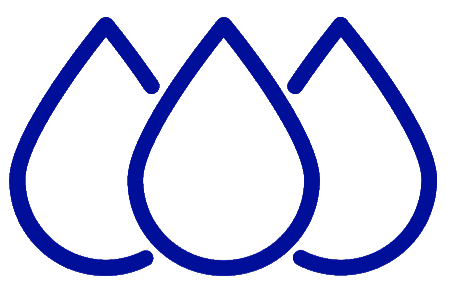

# Hi there 👋🏼
<!--    -->
<p align="left">   
 <!--   -->
 <!--   -->
  <!-- <a href="https://twitter.com/reksas13" target="blank"></a> -->
</p> 
<!--  -->
<!-- https://raw.githubusercontent.com/iampavangandhi/iampavangandhi/master/gifs/Hi.gif -->
<!-- https://github.com/aurimas13/aurimas13/blob/main/docs/images/simple-good-hand-clip-art-170660.png -->

I'm **Aurimas** for Lithuanians and **Alexandre** for others: an AI/Technical Product Manager, Born to Write, and a passionate Teacher from Vilnius, Lithuania. I'm on a quest to explore the ever-evolving world of technology and install my skill sets of [Computer Science](https://www.udemy.com/certificate/UC-00f510ae-c409-42c9-8f61-b75b254c598d/), [Data Engineering](https://www.udemy.com/certificate/UC-2402535e-44ca-4090-9507-29d094ab24ff/), [Machine Learning](https://www.coursera.org/account/accomplishments/specialization/BFC76LUK5Y3W?utm_source=link&utm_medium=certificate&utm_content=cert_image&utm_campaign=sharing_cta&utm_product=s12n) and [AI](https://www.coursera.org/account/accomplishments/specialization/BFC76LUK5Y3W?utm_source=link&utm_medium=certificate&utm_content=cert_image&utm_campaign=sharing_cta&utm_product=s12n) to whoever needs me to lead them.
I am deeply driven by AGI (human-level AI), AI, and Robot-AI Interactions, with a particular emphasis on their role in healthcare, as I discuss in the [Molecule to Machine](https://moleculetomachine.substack.com/) Newsletter.
 
```yaml
name: Aurimas
located_in: Vilnius, Lithuania
from: Vilnius (Lithuania)
job: AI/Technical Product Manager, AI Architect**, Fractional CTO & Writer
education: ["Master's in Chemistry", "Certificates in Computer Science"]
company: CS & ML Design | Code Academy | LIKTA

fields_of_interests: ["Management", "Product Delivery", "Artificial Intelligence", "Artificial General Intelligence", "Chemistry", "Mental Health", "Robot-AI Interaction", "LLM", "Computer Science", "Data Engineering", "Machine Learning"]
technical_background: ["Python", "Java", "Machine Learning", "SQL", "Flask", "JavaScript", "Terraform", "Spark", "Databricks", "Azure", "AWS", "GCP"]
currently_learning: ["Strategy, Management, Delivery, Optimization"]
hobbies: ["Public Speaking", "Writing", "Reading", "Walking", "Running", "Basketball", "Formula 1"]
```
 
Throughout my professional journey, I've been fortunate to work across diverse domains, including teaching Python, developing AI and ML applications/algorithms, and building data engineering solutions. As a lifelong learner, I stay up to date with the latest technological advancements and strive to solve complex problems using my ever-expanding hard- and soft-skill toolbox.

Before the rise of AI, I actively contributed to several projects such as [Machine-Learning-Goodness](https://github.com/aurimas13/Machine-Learning-Goodness), [AI Course](https://github.com/aurimas13/CodeAcademy-AI-Course), [Python Course](https://github.com/aurimas13/Python-Beginner-Course), and daily problems solved on [Solutions-To-Problems](https://github.com/aurimas13/Solutions-To-Problems). I believe in learning by doing, and my hands-on experience with these projects remains a testament to my passion for technology.

In addition to my technical expertise, I'm an avid reader, writer, and public speaker, and a member of several computing, voluntary, and philanthropic organizations.

Feel free to explore my work, <!-- connect with me on [LinkedIn](https://www.linkedin.com/in/aurimasnausedas/), or --> inspect me on [my personal website](https://www.aurimas.io) or through my [X account](https://twitter.com/reksas13) for exciting updates and conversations. I'm always open to collaborations and opportunities to manage exciting projects that need an AI or Technical lead!

Let's build a future where technology and innovation propel the world to new heights. 🚀

<!-- - ⚡ Check out my additional profile [here](https://www.linkedin.com/in/aurimasnausedas/) to find **a more professional 'About' introduction story**. -->
- 📫 **If you're here because you enjoy my social media posts, follow me there**! Details are available in the **Get In Touch** section below!
- 👯 I am a proud member of [Python Software Foundation](https://www.python.org/psf/), [Artificial Intelligence Association of Lithuania](https://lithuania.ai/), [Association for the Advancement of Artificial Intelligence (AAAI)](https://www.aaai.org/) & [IEEE Computer Society](https://www.computer.org/).
- 💬 Even though it might sound irrelevant nowadays, feel free to ask me about the basics of **Python** if needed. My proficiency on it has been built on experience with [Machine-Learning-Goodness](https://github.com/aurimas13/Machine-Learning-Goodness), [AI Course](https://github.com/aurimas13/CodeAcademy-AI-Course), these [Python Solutions](https://github.com/aurimas13/Solutions-To-Problems), daily [LeetCode Solutions](https://leetcode.com/aurimas13/), [Complete Python Developer](https://www.udemy.com/certificate/UC-c3951e1b-dd47-4c1c-9d3f-f153744dd337/) courses, having finished [Learn Python The Hard Way](https://github.com/aurimas13/Python-solutions) book, and various projects such as [Road-App](https://github.com/aurimas13/Road-App), [Time Tracker](https://github.com/aurimas13/Time-Tracker), [Birthday Reminder](https://github.com/aurimas13/BirthdayReminderApp), [Communication of Services](https://github.com/aurimas13/Communication-of-Services), [Calculator](https://github.com/aurimas13/Calculator-program) and [Web Scraper](https://github.com/aurimas13/Web-Scraper) to name a few. I have been working with **Python** since **2010**.
- 💬 Again even though now LLMs can assist you with everything - if you have any questions you can also ask me about [AI/ML/AGI](https://www.udemy.com/certificate/UC-8ff31ab5-1be3-4014-8638-01dc2253c0bc/) as my expertise is constantly expanding irrespective of the old yet completed projects like [this](https://github.com/aurimas13/Machine-Learning-Goodness), [this](https://github.com/aurimas13/CodeAcademy-AI-Course), [this](https://github.com/aurimas13/Coursera-Deep-Learning-Specialization), and now am teaching non-technical people on it whenever get contacted to be thought.
<!-- 💬 Additionally, if you want pieces of advice about [Web Development](https://www.udemy.com/certificate/UC-973ac520-05cd-4573-bc68-47b81bee611f/) - ask me, as my expertise is built on completing several courses ([Django](https://www.udemy.com/certificate/UC-4c6d7d87-39e7-4152-ad6b-74a154a1a34e/), [GCS with Python](https://www.udemy.com/course/develop-a-social-web-party-application-with-python/learn/lecture/9426334#overview), [Spring Boot - Angular](https://www.udemy.com/certificate/UC-c396ed1a-9763-47c7-8322-af7e8ab7d3f6/)) and developing programs found [here](https://github.com/aurimas13/Web-programs). --!>
- 👯 I'm open to managing exciting projects that need a guidance through all the steps to lead fellow developers, AI/ML engineers, fellow managers, stakeholders, designers, HR specialists to name a few through my deep comuputational, disciplined, strategic, first-principle skillsets.

<!--, work on **AI** or **AGI** projects, **Flask** or more **SQL**, create **Java** and **Python-based** technologies by broadening your and my **Development** arsenal, and other invitations to utilize **Java** and **Python**. --!>
- 🌱 In summary: I am an AI/Technical Product Manager who is very tech proficient and constantly expanding my *knowledge* in Management, Delivery, Optimization, and Strategy.


### Work Experience

In the overview below, you will find my most recent work experience:

[](https://www.linkedin.com/company/81844988/admin/)
**AI/Technical Product Manager**, **Teacher** & **Writer** \
[**Self-Employed**](https://www.linkedin.com/company/81844988/admin/) • Self-employed & Contract\
Languages & Technologies:  `Terraform`, `Azure`, `AWS`, `GCP`, `LangChain`, `Databricks`, `Machine Learning`, `PyTorch`, `Tensorflow`, `Keras`, `Terraform`, `Spark`, `GitHub`, `Docker`, `Python`, `Flask`, `Django`, `Hugging Face`, `Java`, `PostgreSQL`, `SQL`, `JavaScript`, `GitLab`, `Teamwork`, `Teaching`, `Strategy`, `Management`, `Delivery`, `Optimization`, `Public Speaking` \
<br/>

[](https://www.vu.lt/)
**Research Engineer (Machine Learning)** \
[**Vilnius University**](https://www.vu.lt/) • Full-time \
Languages & Technologies: `Machine Learning`, `Python`, `Jupyter`, `Docker`, `PyMOL` \
<br/>

<!-- ## 📫 𝙷𝚘𝚠 𝚝𝚘 𝚛𝚎𝚊𝚌𝚑 𝚖𝚎:
𝚈𝚘𝚞 𝚌𝚊𝚗 𝚛𝚎𝚊𝚌𝚑 𝚖𝚎 𝚊𝚝 𝚝𝚑𝚎 𝚎𝚖𝚊𝚒𝚕 𝚒𝚗 𝚖𝚢 G𝚒𝚝H𝚞𝚋 𝚙𝚛𝚘𝚏𝚒𝚕𝚎 or f𝚘𝚕𝚕𝚘𝚠 𝚖𝚢 𝚜𝚘𝚌𝚒𝚊𝚕𝚜! -->
<!-- ## How to reach me: -->
<!-- You can contact me at the email in my GitHub portfolio. Follow my socials! -->
<!-- If you are a workaholic or are late to the coding party -->

<h3 align="left"> Get In Touch:</h3>
<p align="left">
<a href="https://twitter.com/reksas13">
  
</a>
<!-- <a href="https://www.linkedin.com/in/aurimasnausedas">
  
</a> -->
<a href="https://www.instagram.com/reksas13/">
  
</a>
<!-- <a href="https://www.facebook.com/aurimasanausedas">
  
</a> -->
<a href="https://open.spotify.com/user/aurimas.n">
  
</p>
  
<!--  <h3 align="left">  Profile Views:</h3>  -->
 <!-- <p align="left">
      
  </p> -->
<!--

<h3 align="left"> Languages and Tools:</h3>
<p align="left"> <a href="https://www.w3schools.com/cpp/" target="_blank" rel="noreferrer">  </a> <a href="https://www.w3schools.com/cs/" target="_blank" rel="noreferrer">  </a> <a href="https://www.djangoproject.com/" target="_blank" rel="noreferrer">  </a> <a href="https://www.docker.com/" target="_blank" rel="noreferrer">  </a> <a href="https://www.adobe.com/in/products/illustrator.html" target="_blank" rel="noreferrer">  </a> <a href="https://developer.mozilla.org/en-US/docs/Web/JavaScript" target="_blank" rel="noreferrer">  </a> <a href="https://www.linux.org/" target="_blank" rel="noreferrer">  </a> <a href="https://www.mathworks.com/" target="_blank" rel="noreferrer">  </a> <a href="https://www.mongodb.com/" target="_blank" rel="noreferrer">  </a> <a href="https://www.mysql.com/" target="_blank" rel="noreferrer">  </a> <a href="https://www.photoshop.com/en" target="_blank" rel="noreferrer">  </a> <a href="https://www.postgresql.org" target="_blank" rel="noreferrer">  </a> <a href="https://www.python.org" target="_blank" rel="noreferrer">  </a> <a href="https://www.tensorflow.org" target="_blank" rel="noreferrer">  </a> </p>
-->

<h3> My GitHub Activity </h3>
<!-- <h3> 🔔 𝙼𝚢 𝙻𝚊𝚝𝚎𝚜𝚝 𝙶𝚒𝚝𝙷𝚞𝚋 𝙰𝚌𝚝𝚒𝚟𝚒𝚝𝚢 </h3> -->
<p></p>
<!-- <p></p> -->
<!-- <p></p>
<p></p> -->
<!-- <p></p> -->
<br></br>

<!-- <p></p> -->

<!-- [](https://github.com/ashutosh00710/github-readme-activity-graph) -->

<!-- ## 🔔 𝙼𝚢 𝙻𝚊𝚝𝚎𝚜𝚝 𝙶𝚒𝚝𝙷𝚞𝚋 𝙼𝚎𝚝𝚛𝚒𝚌𝚜
 -->
